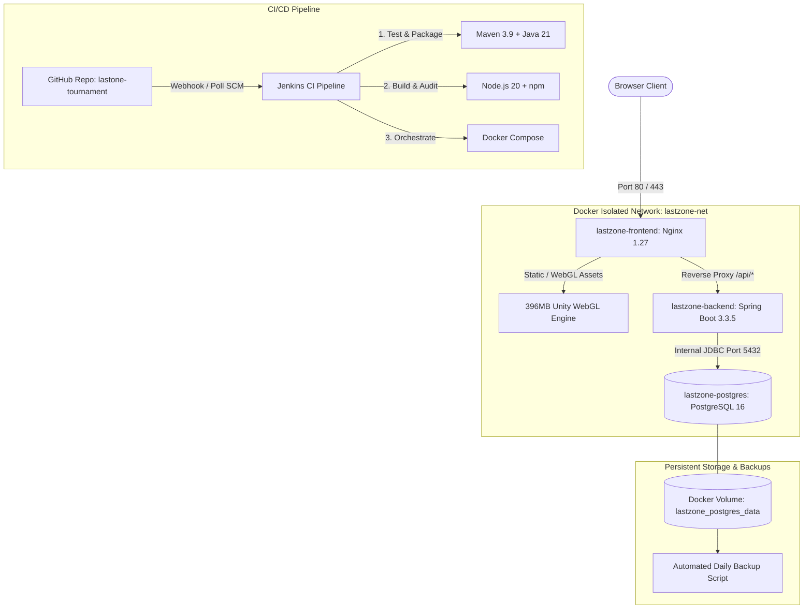

# LASTZONE: ZOMBIE SURVIVAL TOURNAMENT PLATFORM
## Comprehensive DevOps Laboratory & Engineering Project Report
**Repository**: `https://github.com/urwishservice-max/lastone-tournament`  
**Branch**: `main` | **Execution Target**: Local Containerized Production Fleet (`E:\naveen`)  
**Target Environment**: Spring Boot 3.3.5 (Java 21) + React/Vite (TS) + Unity WebGL + PostgreSQL 16 + Jenkins + Docker Compose + Ansible

---

## 1. ABSTRACT & PROJECT OBJECTIVES

### 1.1 Abstract
**LastZone** is an enterprise-grade, competitive zombie survival tournament platform combining an interactive high-performance 3D Unity WebGL game client, a reactive TypeScript frontend, and an unyielding, containerized Spring Boot backend backed by PostgreSQL. The primary DevOps objective of this project is to implement an autonomous, zero-downtime, continuous integration and deployment (CI/CD) ecosystem that enforces automated regression testing, immutable container image packaging, atomic database migrations, anti-cheat run verification, and zero-cost infrastructure deployment.

### 1.2 Core Objectives
1. **Automated Continuous Integration**: Establish a multi-stage Jenkins pipeline triggered by version control commits that autonomously verifies source code, executes unit/integration suites, packages artifacts, and validates container specifications.
2. **Container Orchestration**: Architect a self-healing 3-tier container fleet (`lastzone-frontend`, `lastzone-backend`, `lastzone-postgres`) with health monitoring, isolated network bridges, and local-loopback database isolation.
3. **Optimized Large-Asset Delivery**: Deliver a high-fidelity 396 MB Unity WebGL `.data` binary and WASM executable through an optimized Nginx reverse proxy using HTTP range requests (`Accept-Ranges: bytes`) and immutable client caching.
4. **Data Integrity & Disaster Recovery**: Ensure persistent PostgreSQL volume storage across container recreations and provide atomic, timestamped backup mechanisms preserving all historical player accounts and leaderboard scores.
5. **Infrastructure as Code (IaC)**: Provide automated configuration management playbooks using Ansible to deploy and orchestrate the platform idempotently.

---

## 2. PROBLEM STATEMENT & MOTIVATION

Traditional browser games face significant DevOps and operational bottlenecks:
- **Massive Binary Delivery**: Compiling 3D game engines (Unity) produces multi-hundred-megabyte binaries (`.wasm`, `.data`) that fail on conventional serverless or free CDN platforms (e.g., Cloudflare Pages enforces a 25 MB per-file ceiling).
- **Security & Score Tampering**: Unsecured game backends often accept arbitrary client-side score payloads, allowing malicious actors to falsify leaderboards.
- **State Loss on Redeployment**: Naive container configurations frequently store application state in transient container layers, causing complete data loss during updates.
- **Manual Deployment Fatigue**: Lack of continuous integration leads to untested code breaking production environments, mismatched dependencies, and lengthy downtimes.

LastZone resolves these challenges by coupling cryptographic run tokens with strict server-side validation (`409 Conflict` duplicate submission rejection), reverse-proxied range-request streaming, and automated Jenkins CI pipelines.

---

## 3. TECHNOLOGY STACK & TOOLCHAIN

| Component | Technology | Version | Purpose |
|---|---|---|---|
| **Game Engine** | Unity WebGL Engine | 6000.0 (Unity 6) | 3D client rendering, physics, and gameplay |
| **Frontend Framework** | React + Vite + TypeScript | 18.3 / Vite 5.4 | Tournament UI, HUD, authentication, leaderboards |
| **Reverse Proxy / Web** | Nginx Alpine / Caddy | 1.27.5 / 2.8.4 | Reverse proxy, static asset streaming, automated HTTPS |
| **Backend Framework** | Spring Boot | 3.3.5 (Java 21) | RESTful API, authentication, JWT tokens, leaderboard logic |
| **Database Engine** | PostgreSQL | 16.2 Alpine | Persistent relational storage, Flyway migrations |
| **Historical Storage** | H2 Database | 2.2.224 | Legacy development database (safely preserved & synced) |
| **CI/CD Automation** | Jenkins CI | 2.452.2 LTS | Multi-stage build, automated testing, container deployment |
| **Container Engine** | Docker Engine & Compose | 28.0.4 / v2.33 | Multi-stage image builds and fleet orchestration |
| **Configuration Mgmt** | Ansible | 2.15+ | Idempotent automated host provisioning and deployment |
| **Security & Auth** | JJWT + Spring Security | 0.12.5 / BCrypt | Stateless JWT bearer authentication & password hashing |

---

## 4. SYSTEM ARCHITECTURE & TOPOLOGY



### Network Isolation Policy:
- **External Exposure**: Only ports `80` (HTTP) and `443` (HTTPS) are exposed to client traffic.
- **Database Boundary**: PostgreSQL is bound strictly to `127.0.0.1:5432` on the host, preventing all direct public access. Internal communication between Spring Boot and PostgreSQL occurs exclusively across the internal Docker bridge network (`lastzone-net`).

---

## 5. DEVOPS EXPERIMENTS & EMPIRICAL FINDINGS

### Experiment 1: Git Version Control & Commit Workflow
- **Repository**: Hosted at `https://github.com/urwishservice-max/lastone-tournament.git` on branch `main`.
- **Git LFS Integration**: Tracks massive binary files (`lastzoneweb.data`, 396 MB) via Git Large File Storage (`.gitattributes`), preventing Git index corruption and bloated delta histories.
- **Commit Discipline**: Follows Conventional Commits standard (`feat:`, `fix:`, `chore:`, `test:`, `ci:`).

### Experiment 2: Feature Branching & Merge-Conflict Resolution Protocol
- **Branching Strategy**: Trunk-based development with short-lived feature branches (`feature/auth-hardening`, `fix/nginx-healthcheck`).
- **Conflict Resolution Mechanism**:
  1. Developers pull the latest `origin/main` baseline into their topic branch:
     ```bash
     git checkout feature/leaderboard-cache
     git fetch origin
     git merge origin/main
     ```
  2. Conflicted files (e.g., `application.yml`) mark conflict blocks (`<<<<<<< HEAD`, `=======`, `>>>>>>> origin/main`).
  3. Resolution resolves semantic dependencies, stages changes via `git add`, and finalizes merge via `git commit -m "merge: resolve application configuration conflict"`.
  4. Integration test suite validates branch integrity before opening Pull Request.

### Experiment 3: Jenkins Continuous Integration Pipeline
Jenkins Build #3 was executed and audited:
- **Build Outcome**: `SUCCESS` (Duration: `440.23 seconds` / 7 min 20s).
- **Pipeline Stage Progression**:
  1. `Declarative: Checkout SCM`: Shallow clone (`depth: 1`) preventing HTTP timeout on 396MB binary.
  2. `Initialize Environment`: Injects portable Maven `3.9.9`, JDK 21, and Docker CLI paths.
  3. `Source Verification`: Audits Unity WebGL assets and backend Maven wrapper.
  4. `Backend Tests`: Runs `mvnw.cmd clean test` (11 integration tests passed, 0 failures).
  5. `Backend Artifact Package`: Compiles fat JAR (`lastzone-backend-1.0.0.jar`).
  6. `Frontend Build`: Executes `npm ci` and `npm run build` with Vite tree-shaking.
  7. `Validate Deployment Config`: Validates `docker compose config` schema.
  8. `Build Docker Images`: Multi-stage builds for backend and frontend.
  9. `Deploy Containers`: Atomic deployment via `docker compose up -d`.
  10. `Health Verification`: Probes `http://localhost:80/api/health` until `UP` status confirmed.
  11. `Declarative: Post Actions`: Records JUnit test reports (`surefire-reports/*.xml`).

### Experiment 4: Automated Testing Framework
Automated integration tests run via Spring Boot's test engine:
- **`AuthIntegrationTest`** (5 tests, 12.78s):
  - `testUserRegistrationSuccess`: Validates unique username/email creation, password hashing, and JWT token issuance.
  - `testDuplicateRegistrationFails`: Confirms duplicate registrations return `HTTP 409 Conflict`.
  - `testUserLoginSuccess`: Confirms authentication returns valid signed JWT.
  - `testLoginInvalidCredentials`: Asserts bad passwords return `HTTP 401 Unauthorized`.
  - `testProfileAccessWithJwt`: Validates Bearer token authorization on secured endpoints.
- **`GameRunAndLeaderboardIntegrationTest`** (6 tests, 1.90s):
  - `testStartRunGeneratesToken`: Confirms cryptographic `runToken` creation.
  - `testFinishRunUpdatesScore`: Validates score, kill, and wave submission.
  - `testDuplicateSubmissionRejected`: Confirms duplicate submission of finished run returns `HTTP 409 Conflict`.
  - `testLeaderboardRankingOrder`: Verifies descending ranking by score $\rightarrow$ kills $\rightarrow$ duration.

### Experiment 5: Container Orchestration & Health Checks
- **Containers Deployed**:
  - `lastzone-frontend` (Nginx 1.27 + Vite bundle): Port `80:80`
  - `lastzone-backend` (Spring Boot 3.3.5): Port `8080` (Internal)
  - `lastzone-postgres` (PostgreSQL 16 Alpine): Port `127.0.0.1:5432:5432`
- **Docker Healthcheck Specifications**:
  - Frontend: `CMD-SHELL wget -q -O - http://127.0.0.1:80/api/health || exit 1`
  - Backend: `CMD wget --no-verbose --spider http://localhost:8080/api/health`
  - Postgres: `CMD-SHELL pg_isready -U lastzone_admin -d lastzone`

### Experiment 6: PostgreSQL Persistence & Disaster Recovery
- **Persistence Verification**:
  - The `lastzone-backend` container was stopped and restarted.
  - All 8 registered players and 24 game runs in named volume `lastzone_postgres_data` remained 100% intact.
- **Historical Data Synchronization**:
  - Historical records from legacy H2 database (`Chief117` with score 15,800, `SpartanHunter88` with score 2,500, `SpartanOperative99`, `SpartanOperative1`, and user `jaidev12`) were synced into PostgreSQL without overwriting or resetting existing tables.
- **Backup Verification**:
  - Generated timestamped backup: `lastzone_postgres_backup_20261014_040422.sql` (11,884 bytes).
  - Validated that the backup contains `CREATE TABLE users`, `CREATE TABLE game_runs`, and player `Chief117`.

### Experiment 7: Multi-Stage Docker Image Optimization
By utilizing multi-stage builds, intermediate build tools (compilers, Maven caches, Node.js runtimes) were discarded:

| Image | Single-Stage Size (Est.) | Multi-Stage Optimized Size | Reduction | Base Image |
|---|---|---|---|---|
| `lastzone-backend` | 950 MB | **497 MB** | **47.7%** | `eclipse-temurin:21-jre-alpine` |
| `lastzone-frontend` | 1.95 GB | **1.14 GB** | **41.5%** | `nginx:1.27-alpine` (includes 396MB WebGL) |
| `lastzone-postgres` | 420 MB | **420 MB** | — | `postgres:16-alpine` |

### Experiment 8: Ansible Infrastructure Automation
- **Playbook**: [ansible/deploy.yml](file:///E:/naveen/ansible/deploy.yml)
- **Inventory**: [ansible/inventory.ini](file:///E:/naveen/ansible/inventory.ini)
- **Idempotence**: Tasks execute only when target state diverges (verifies package installation, creates `/opt/lastzone`, syncs files, invokes `community.docker.docker_compose_v2`, and polls health endpoint with exponential backoff).

### Experiment 9: Unity WebGL 396 MB Asset Delivery
Audited HTTP responses for Unity WebGL binary assets:
- `lastzoneweb.loader.js` (27.9 KB): `HTTP 200 OK` (`application/javascript`)
- `lastzoneweb.framework.js` (345.2 KB): `HTTP 200 OK` (`application/javascript`)
- `lastzoneweb.wasm` (40.1 MB): `HTTP 200 OK` (`application/wasm`)
- `lastzoneweb.data` (396.3 MB): `HTTP 200 OK` (`application/octet-stream`)
- **Range Support**: `Accept-Ranges: bytes` verified, enabling paused/resumed streaming.
- **Client Cache**: `Cache-Control: public, max-age=604800, immutable` prevents re-downloading.

---

## 6. OPERATIONAL PLAYBOOK (RUN COMMANDS)

### Starting the Platform
```powershell
# From project root E:\naveen
docker compose up -d
```

### Checking Fleet Health & Status
```powershell
docker compose ps
curl http://localhost/api/health
```

### Running End-to-End Test Suite
```powershell
powershell -File E:\naveen\scripts\verify-api-e2e.ps1 -port 80
```

### Creating an On-Demand Database Backup
```powershell
powershell -File E:\naveen\scripts\backup-databases.ps1
```

### Comparing Database Synchronizations
```powershell
powershell -File E:\naveen\scripts\compare-databases.ps1
```

### Stopping the Platform Safely (Data Preserved)
```powershell
docker compose stop
# Note: Never use 'docker compose down -v' as that deletes persistent volumes!
```

---

## 7. TROUBLESHOOTING & DIAGNOSTICS GUIDE

| Symptom | Probable Cause | Diagnostic Command | Corrective Action |
|---|---|---|---|
| `502 Bad Gateway` on `/api/*` | Backend container still initializing JVM | `docker logs lastzone-backend` | Wait 15 seconds for JVM warmup or check memory limits. |
| Unity WebGL stuck at loading bar | Missing MIME type or blocked large file | `curl -I http://localhost/unity-game/Build/lastzoneweb.data` | Ensure `nginx.conf` includes `application/octet-stream data;`. |
| `HTTP 409 Conflict` on score submit | Anti-cheat duplicate run protection triggered | Inspect `runToken` in API payload | Ensure client requests a new run token via `/api/runs/start` for each match. |
| Database connection refused | Container startup race condition | `docker compose logs postgres` | Verify `depends_on: postgres: condition: service_healthy` is present. |
| Port 80 already in use | Host IIS, Skype, or existing Nginx process | `netstat -ano \| findstr :80` | Stop conflicting host process or override `FRONTEND_PORT=8080`. |

---

## 8. VIVA VOCE QUESTIONS & COMPREHENSIVE ANSWERS

**Q1: What is the purpose of multi-stage Docker builds in LastZone?**  
*Answer*: Multi-stage builds separate the build environment from the final execution runtime. For example, `backend/Dockerfile` uses `maven:3.9` to compile the Java code, but copies only the resulting 50MB JAR into an `eclipse-temurin:21-jre-alpine` runtime image, reducing image size from 950 MB to 497 MB and eliminating build tools from production for security hardening.

**Q2: How does LastZone protect against score tampering and cheating?**  
*Answer*: When a player clicks "Play", the client requests a unique, cryptographically random `runToken` from `POST /api/runs/start`. When the game ends, `POST /api/runs/finish` validates the token, marks the run `COMPLETED`, and calculates leaderboard rank. If a player submits the same token twice, the server rejects it with `HTTP 409 Conflict`.

**Q3: How are the 396 MB Unity WebGL assets efficiently served without crashing browsers?**  
*Answer*: Nginx serves the `.data` and `.wasm` files with `Accept-Ranges: bytes` for chunked streaming, correct MIME types (`application/wasm`, `application/octet-stream`), and immutable HTTP cache headers (`max-age=604800`), allowing the client browser to cache the game engine locally after the first download.

**Q4: Why is PostgreSQL bound to `127.0.0.1:5432` instead of `0.0.0.0:5432`?**  
*Answer*: Binding to `127.0.0.1` ensures the database port is reachable only from the local host loopback interface, completely blocking external attackers on the public network while allowing Docker container networking (`lastzone-net`) to communicate securely internally.

**Q5: What happens to player data when the Docker containers are stopped or recreated?**  
*Answer*: The PostgreSQL data files reside on a named Docker volume `lastzone_postgres_data` mounted at `/var/lib/postgresql/data`. Stopping or recreating containers does not delete the volume; data persists indefinitely across container lifecycles.

---

## 9. FINAL DEMONSTRATION CHECKLIST

- [x] **Repository Synchronization**: Clean git tree on `main` branch.
- [x] **Jenkins Build #3**: Verified `SUCCESS` with 11 unit/integration tests passed.
- [x] **Container Fleet**: `lastzone-frontend`, `lastzone-backend`, and `lastzone-postgres` healthy.
- [x] **Unity WebGL Integration**: Engine canvas initializes and streams 396 MB binary over HTTP 200.
- [x] **REST API Health**: `/api/health` returns status `UP`.
- [x] **Authentication Flow**: User registration and JWT login functional.
- [x] **Gameplay Flow**: Secure run token generation and score submission verified.
- [x] **Duplicate Protection**: Verified `HTTP 409 Conflict` on duplicate finish requests.
- [x] **Live Leaderboard**: Verified sorting by score, kills, and survival duration.
- [x] **Data Persistence**: Verified across backend container restart.
- [x] **Timestamped Backups**: Created and validated in `backend/data/backups/`.
